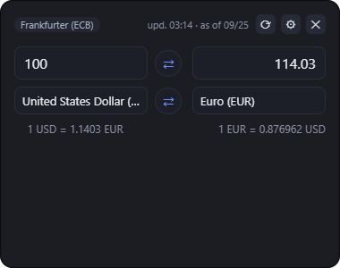
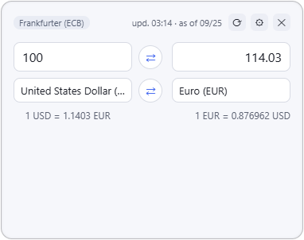
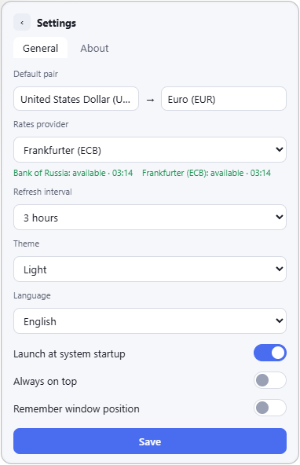

# CWidget

A lightweight currency-converter **tray widget** for Windows and Linux. Built with [Go](https://go.dev) + [Wails v2](https://wails.io). Lives in the system tray, converts on every keystroke, never touches your taskbar.








## Features

- **Instant conversion** — type in either field, the other side recalculates on every keystroke; thousands grouping, both `,` and `.` accepted.
- **Favorites** — star currencies once and they pin to the top of every dropdown, across all providers.
- **Tray-native behavior** — left click toggles the widget (open/close), right click opens the menu, clicking elsewhere hides it (with an optional stay-on-top mode).
- **Multi-monitor aware** — optionally remembers where you dragged the window, even on a second monitor; if that monitor disappears, the widget falls back safely.
- **Two rate sources out of the box** — Central Bank of Russia and Frankfurter(ECB). Adding another API is one interface + one registry entry.
- **Failover & offline cache** — if the selected source is down, a fallback takes over (with a visible ⚠ warning); if everything is down, today's or yesterday's cached rates still work. You always know what you are looking at.
- **Dark & light themes**, **English & Russian UI**.
- **Autostart** — registry on Windows, XDG autostart on Linux; the tray menu and the settings toggle stay in sync.
- **Full self-uninstall** — one button removes the app, its data and the autostart entry (portable builds).
- All app data — settings, rates cache, logs — lives in one folder; nothing is scattered across the system.

## Install

Grab a build from [Releases](https://github.com/voxnord/cwidget/releases):

- **Windows** — portable `.exe` or an NSIS installer. Requires the [WebView2 Runtime](https://developer.microsoft.com/microsoft-edge/webview2/)(preinstalled on Windows 10/11). SmartScreen may warn about an unsigned binary: "More info → Run anyway".
- **Linux** — a `tar.gz` binary. Requires GTK and WebKitGTK:
    ```bash
    sudo apt install libgtk-3-dev libwebkit2gtk-4.1-dev
    ```

Optional: `wmctrl` (taskbar hiding on X11). The tray uses D-Bus (AppIndicator): works out of the box on KDE/Ubuntu; GNOME needs the AppIndicator extension.

### Uninstall

- **Windows portable**: Settings → About → _"Uninstall the app and its data"_ — removes the binary, settings, cache and the autostart entry.
- **Installed via setup.exe**: remove it through Windows "Apps & features".
- **Linux**: delete the binary, then `~/.config/Voxs_CurrencyWidget`.

## Build from source

Requirements: [Go 1.21+](https://go.dev/dl/) and the [Wails v2 CLI](https://wails.io/docs/gettingstarted/installation):

```bash
go install github.com/wailsapp/wails/v2/cmd/wails@v2.15.0
```

Linux additionally needs the dev packages listed above.

```powershell
# Windows
.\build.ps1 # -> build\bin\CWidget.exe
.\build.ps1 -Installer # + NSIS installer
.\build.ps1 -Archive # + zip in build\dist
```

```bash
# Linux
WEBKIT41=1 ./build.sh   # distros shipping WebKitGTK 4.1 only (Ubuntu 22.04+)
```

The version comes from the `VERSION` file; icons are synced and the exe version info is generated by the build scripts automatically. For UI development: `wails dev`.

## How it works
**Rates freshness.** Both sources publish official rates **once per working day** (~15:30 MSK for the CBR, ~16:00 CET for the ECB). The widget polls on a configurable interval and, additionally, schedules a check right after the expected publication — so the new day's rate appears within minutes, not up to a full interval later. The badge shows `upd. HH:MM · as of DD.MM` — _when we last fetched_ and _which date the quotes are from_.

**Failover & offline.** The fetch chain is: selected source → fallback sources → **local cache** (last resort, valid for up to four days — daily-published rates stay current across weekends, and the quote date is always shown). When a fallback answers instead of your selected source, a ⚠ appears next to the source badge; if even the cache is too old and nothing responds, the widget shows an honest "no connection" and keeps retrying with a backoff. Cached snapshots are kept **per source**: a pair the fallback cannot serve is still served from the cached snapshot, marked as *cached* with its quote date.

**Diagnostics**

Everything is logged to `cwidget.log` next to the settings (append-mode, size-capped):

- `%AppData%\Voxs_CurrencyWidget\cwidget.log` (Windows)
- `~/.config/Voxs_CurrencyWidget/cwidget.log` (Linux)

What to look for: every tray click produces a `[tray] ...` line (clicks with no line = delivery failure, not app logic), `[panic]` and `[frontend:error]` records carry full stacks, `[rates]` lines show every fetch outcome (source, fallback flag, quote date), and `[window]` lines trace each show/position step.

**Architecture**

```text
main.go ──► app/ (Wails bindings, lifecycle, settings API)
              ├─► rates/ rate sources behind the Provider interface
              │ (Adapter pattern + registry + disk cache)
              ├─► tray/ backend contract (backend.go) +
              │ per-OS implementations (self-contained Win32 on Windows, energye/D-Bus on Linux)
              ├─► popup/ Win32 window tweaks (per-OS, build tags)
              ├─► autostart/ registry / XDG (per-OS, build tags)
              └─► config/ JSON settings, atomic writes
frontend/dist/ vanilla ES-modules, no bundler
```

**Add a rate provider** — implement one interface, register one entry:

```go
// rates/mysource.go
func (s *MySource) Name() string { return "My Source" }
func (s *MySource) Fetch(ctx context.Context) (*rates.Table, error) { /* ... */ }
```

```go
// main.go — the provider registry
factory["mysource"] = func(c *http.Client) rates.Provider { return rates.NewMySource(c) }
```

**Add a language** — copy `i18n/locales/en.json` to `de.json`, translate, rebuild. The language appears in the settings and in the tray menu automatically; missing keys fall back to English.

## Limitations

- **Windows 10**: window corners are clipped by a 1-bit GDI region (no system-level window rounding before Win11), so the corner edge is slightly stepped; Windows 11 uses smooth native DWM rounding.
- **Linux**: left/right click distinction in the tray depends on the desktop environment (AppIndicator does not report the button — the menu opens on any click); taskbar hiding needs X11 + `wmctrl` and is not possible on Wayland.

## Contributing

PRs are welcome — especially new rate providers and translations; see _Architecture_ above for the two extension points.

## License

[MIT](LICENSE)